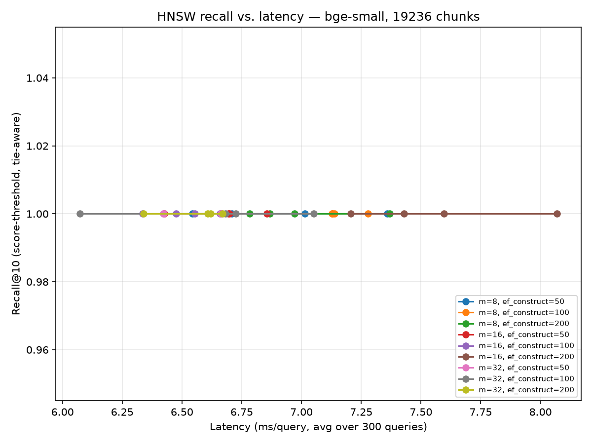

# HNSW Recall vs. Latency — Phase 3

Encoder: `BAAI/bge-small-en-v1.5` (dev workhorse — bge-large/BGE-M3 use a config chosen from this curve, not their own sweep). Corpus: all 19,236 heading-aware chunks. Query set: 300 vectors sampled from the corpus itself (self-match excluded), since Phase 4's golden set doesn't exist yet — this measures HNSW's fidelity to the exact nearest-neighbor structure, not retrieval quality for real questions (Phase 6).

**39.7% of the corpus's 19,236 vectors are exact-duplicate embeddings** (rounded to 5 decimal places) — the largest single group is 1,354 issues whose entire heading-aware chunk is the literal string `_No response_`, a GitHub issue-template placeholder (same boilerplate-pollution category as Phase 1's product_area findings). With that many exact ties, "the" top-10 nearest neighbors is not uniquely defined: naive ID-set recall (`Recall@10 (ID)` below) penalizes HNSW for returning a *different, equally-correct* tied neighbor than the arbitrary one brute-force KNN happened to return. `Recall@10 (score)` is the corrected metric — it credits any result whose similarity score matches or beats the true k-th-best score, tie or not — and is the one the plot uses.

| m | ef_construct | ef_search | Recall@10 (ID) | Recall@10 (score) | Latency (ms) | Build time (s) |
|---|---|---|---|---|---|---|
| 8 | 50 | 50 | 0.6783 | 1.0000 | 6.54 | 8.14 |
| 8 | 50 | 100 | 0.6783 | 1.0000 | 6.71 | 8.14 |
| 8 | 50 | 200 | 0.6783 | 1.0000 | 7.01 | 8.14 |
| 8 | 50 | 400 | 0.6783 | 1.0000 | 7.36 | 8.14 |
| 8 | 100 | 50 | 0.6687 | 1.0000 | 7.14 | 7.71 |
| 8 | 100 | 100 | 0.6687 | 1.0000 | 7.13 | 7.71 |
| 8 | 100 | 200 | 0.6687 | 1.0000 | 7.13 | 7.71 |
| 8 | 100 | 400 | 0.6687 | 1.0000 | 7.28 | 7.71 |
| 8 | 200 | 50 | 0.6680 | 1.0000 | 7.37 | 7.62 |
| 8 | 200 | 100 | 0.6680 | 1.0000 | 6.87 | 7.62 |
| 8 | 200 | 200 | 0.6680 | 1.0000 | 6.97 | 7.62 |
| 8 | 200 | 400 | 0.6680 | 1.0000 | 6.78 | 7.62 |
| 16 | 50 | 50 | 0.6680 | 1.0000 | 6.43 | 7.65 |
| 16 | 50 | 100 | 0.6680 | 1.0000 | 6.85 | 7.65 |
| 16 | 50 | 200 | 0.6680 | 1.0000 | 6.69 | 7.65 |
| 16 | 50 | 400 | 0.6680 | 1.0000 | 6.70 | 7.65 |
| 16 | 100 | 50 | 0.6697 | 1.0000 | 6.48 | 7.64 |
| 16 | 100 | 100 | 0.6697 | 1.0000 | 6.66 | 7.64 |
| 16 | 100 | 200 | 0.6697 | 1.0000 | 6.34 | 7.64 |
| 16 | 100 | 400 | 0.6697 | 1.0000 | 6.55 | 7.64 |
| 16 | 200 | 50 | 0.6863 | 1.0000 | 7.21 | 7.65 |
| 16 | 200 | 100 | 0.6863 | 1.0000 | 7.60 | 7.65 |
| 16 | 200 | 200 | 0.6863 | 1.0000 | 7.43 | 7.65 |
| 16 | 200 | 400 | 0.6863 | 1.0000 | 8.07 | 7.65 |
| 32 | 50 | 50 | 0.6777 | 1.0000 | 6.42 | 7.93 |
| 32 | 50 | 100 | 0.6777 | 1.0000 | 6.42 | 7.93 |
| 32 | 50 | 200 | 0.6777 | 1.0000 | 6.66 | 7.93 |
| 32 | 50 | 400 | 0.6777 | 1.0000 | 6.66 | 7.93 |
| 32 | 100 | 50 | 0.6727 | 1.0000 | 6.07 | 7.63 |
| 32 | 100 | 100 | 0.6727 | 1.0000 | 7.05 | 7.63 |
| 32 | 100 | 200 | 0.6727 | 1.0000 | 6.68 | 7.63 |
| 32 | 100 | 400 | 0.6727 | 1.0000 | 6.73 | 7.63 |
| 32 | 200 | 50 | 0.6703 | 1.0000 | 6.34 | 7.87 |
| 32 | 200 | 100 | 0.6703 | 1.0000 | 6.67 | 7.87 |
| 32 | 200 | 200 | 0.6703 | 1.0000 | 6.62 | 7.87 |
| 32 | 200 | 400 | 0.6703 | 1.0000 | 6.61 | 7.87 |

## Conclusion

**Recall@10 (score) is 1.0000 for all 36 configurations.** At this corpus scale
(19,236 points), HNSW's approximation costs zero measured recall regardless of
`m`, `ef_construct`, or `ef_search` — the tradeoff curve plan.md anticipated
doesn't materialize yet. This tracks with how HNSW is known to behave: its
approximation error grows with corpus size and graph traversal depth needed to
escape local optima, and ~19K points is small enough that even a sparse graph
(`m=8`) with a shallow search (`ef_search=50`) already finds every exact
neighbor. Latency is also flat (6.1–8.1ms across all 36 runs, no consistent
trend with any parameter) — noise at this scale, not signal.

**Chosen config: `m=16, ef_construct=100, ef_search=100`** — Qdrant's own
defaults. With recall saturated and latency indistinguishable from noise,
there's no measured reason to deviate from them. This is a decision to revisit,
not a permanent one: the curve should be re-run once the corpus is an order of
magnitude larger (real production scale, or after Phase 5 adds sparse vectors
and the collection grows), since that's when `m`/`ef_construct`/`ef_search`
are expected to actually start trading recall against latency.
