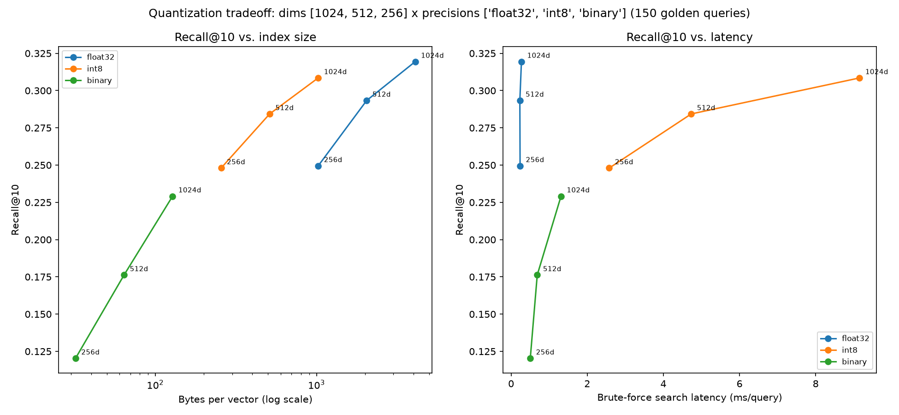

# Quantization Tradeoff — int8, Binary, Matryoshka Truncation (Phase 12 Unit 5)

150 real dev-positive golden queries, real `bge-large-en-v1.5` corpus vectors (`data/processed/vectors_bge_large.npy`, Phase 3's already-computed 19,236-chunk embedding run -- zero new corpus embedding calls). Exact brute-force cosine/int8/Hamming search over 9 real (dimension x precision) combinations, same `exclude_doc_id` convention as every other retrieval measurement in this project.

## Read this before the numbers: brute-force search does not match the shipped baseline, and that's expected

Live Qdrant HNSW search and this script's exact brute-force search agree on only **57.8%** of their top-10 results on average, for the same real queries against the same real vectors. Of the real ground-truth chunks either search finds, **348 are found only by the live index** vs. **95 found only by brute force** -- a real, ~3.6x asymmetry, not noise. The likely mechanism (see design record 12e §6): this golden set's ground truth was labeled from candidates the live Qdrant index itself surfaced (`aegis/eval/retrieve_candidates.py`, Phase 4), so the labels are structurally biased toward what that specific approximate index finds, not toward true nearest-neighbor-by-cosine. **Every row below uses brute-force search consistently, so the *relative* recall changes across dimension/precision are a clean, isolated measurement of quantization's effect. The *absolute* recall level should not be compared to `docs/results/rerank-tradeoff.md`'s 0.4324** (that number used live HNSW search, a different algorithm, over the same full-precision vectors).

## The sweep

| dim | precision | bytes/vector | recall@10 | ndcg@10 | latency (ms/query) |
|---|---|---|---|---|---|
| 1024 | float32 | 4096 | 0.3194 | 0.5324 | 0.272 |
| 1024 | int8 | 1024 | 0.3085 | 0.5237 | 9.152 |
| 1024 | binary | 128 | 0.2291 | 0.3976 | 1.312 |
| 512 | float32 | 2048 | 0.2934 | 0.5016 | 0.230 |
| 512 | int8 | 512 | 0.2843 | 0.4943 | 4.732 |
| 512 | binary | 64 | 0.1762 | 0.3239 | 0.687 |
| 256 | float32 | 1024 | 0.2495 | 0.4383 | 0.237 |
| 256 | int8 | 256 | 0.2480 | 0.4370 | 2.577 |
| 256 | binary | 32 | 0.1203 | 0.2227 | 0.504 |

## Two disclosed limitations in what 'latency' and 'Matryoshka' mean here

**Latency is this brute-force NumPy implementation's, not a production quantized index's.** Binary search here (a Python loop computing exact Hamming distance via `np.bitwise_count`) measures 1.312 ms/query at dim=1024 -- *slower* than float32's 0.272 ms/query, because a single BLAS `matmul` (float32) is far more optimized in NumPy than an unaccelerated per-query popcount loop, not because binary vectors are intrinsically slower to compare. A real production binary/int8 index (Qdrant's own scalar/binary quantization, SIMD-accelerated) would show the opposite ordering -- less data moved, faster comparison. The size column (bytes/vector) is the trustworthy, implementation-independent number here; the latency column measures this script's own arithmetic, disclosed as such rather than presented as a production-representative curve.

**`bge-large-en-v1.5` was not trained with a Matryoshka (nested-dimension) objective.** True MRL models are trained so that a prefix of the embedding is itself a good, independently-useful lower-dimensional embedding; this model has no such guarantee, so the 512/256-dim rows below measure what naive truncation costs on a model never optimized to survive it -- a real, worse-than-MRL number, not a demonstration of Matryoshka's actual value proposition. Reported as-is, per CLAUDE.md: measure the real mechanism on this project's real model, don't substitute an illustrative one.
