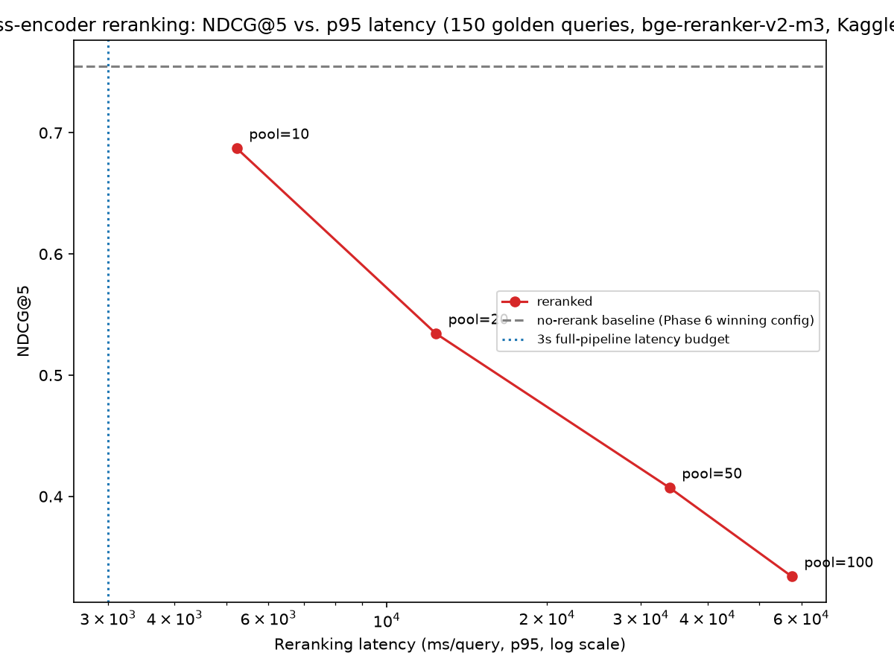

# Reranking Pool-Size Sweep — Phase 7

All numbers: 150 positive queries, `golden_set_v1.jsonl` (dev split), same corpus and query set as Phase 6. Base retriever is Phase 6's winning config (heading-aware chunking, contextual enrichment off, dense retrieval, `bge-large-en-v1.5`). Reranker is `BAAI/bge-reranker-v2-m3` (cross-encoder), scoring `(query, chunk_text)` pairs. Metrics via `ranx` (`aegis.eval.metrics`).

**Compute note:** this sweep did not run on this project's own M1 Pro 16GB. MPS hit macOS's "stuck" scheduler state twice under this session's system-wide memory pressure before a single batch completed; CPU inference was stable but real corpus-length text (up to ~400 tokens/chunk) measured at ~780ms/pair, projecting a ~5.7 hour sweep. The sweep was moved to a free Kaggle T4 GPU instead — see design record §3 and §6 for the full account, including a first GPU attempt that also crashed (CUDA OOM at pool=50, fixed by reducing batch size and clearing the CUDA cache between pool sizes).

## 1. The sweep

Dense candidates are retrieved once per query at pool=100 (the largest size swept), then reranked at each pool size by scoring only the top-N of that same list — isolating the reranking variable from any retrieval-side variance.

| Pool size | NDCG@5 | Δ vs. no-rerank | Recall@10 | MRR | Rerank latency (p50) | Rerank latency (p95) |
|---|---|---|---|---|---|---|
| **no-rerank baseline** (Phase 6 winning config) | **0.7550** | — | **0.4324** | **0.8630** | — | — |
| 10 | 0.6873 | −0.0677 (−9.0%) | 0.4324 | 0.8119 | 1,560 ms | 5,227 ms |
| 20 | 0.5344 | −0.2206 (−29.2%) | 0.2951 | 0.7485 | 3,409 ms | 12,362 ms |
| 50 | 0.4072 | −0.3478 (−46.1%) | 0.2003 | 0.6328 | 8,569 ms | 33,936 ms |
| 100 | 0.3340 | −0.4210 (−55.8%) | 0.1471 | 0.5401 | 16,210 ms | 57,563 ms |

Recall@10 is unchanged between the baseline and pool=10 (0.4324 both) because it's an order-independent set-membership metric and pool=10 reranks the exact same 10 chunks the baseline already used — only their order changes. Every other pool size, and every order-sensitive metric, gets **monotonically worse** as the pool grows.

## 2. Why reranking hurts here — the mechanism, not a guess

This isn't noise or a bug in the reranking pipeline. Verified directly: ran the real model locally (CPU, `tests`-adjacent scratch check) on one query's top-20 candidates and inspected the output. The cross-encoder correctly ranked the single most on-point passage #1 with high confidence (0.9563) — a different GitHub issue describing the exact same problem the query asked about. It is not confused or broken.

The real cause is in how this golden set's ground truth was built (`aegis/eval/auto_label.py`): a **token-overlap heuristic** — any candidate chunk sharing ≥15% of the query's individual words is labeled relevant, explicitly "biased toward inclusion" (the function's own docstring). Measured directly: the median golden query has **17 ground-truth chunks spanning 12 distinct documents**. That is a "broadly on-topic" standard, not "directly answers this specific question." A bi-encoder's cosine similarity clusters broadly-on-topic text together fairly tightly (which happens to satisfy this permissive ground truth reasonably well by construction). A cross-encoder is trained for the opposite: sharp, specific, one-passage-at-a-time relevance judgment — and a sharper judge disagreeing with a looser label set shows up as "worse," even when, qualitatively, its judgment is the more defensible one.

This is the same class of finding as Phase 6's contextual-enrichment result (a plan.md default expectation failing on this specific corpus/golden-set combination) — but this time the root cause is the eval methodology itself, not the retrieval config. It's a genuine limitation of the Phase 4 auto-labeling process, worth flagging for Phase 11's judge-agreement measurement (Cohen's κ against Opus), not a reason to distrust the reranker.

## 3. Pool size vs. the latency budget

Every pool size **already exceeds** the full-pipeline 3-second p95 budget (plan.md, Phase 13's target) from reranking alone, before retrieval, generation, or anything else runs:

- pool=10: p50 1.56s (over half the entire budget), p95 5.23s (74% over budget by itself)
- pool=100: p95 57.6s — roughly 19x the entire pipeline's budget for one stage

There is no pool size in this sweep that is simultaneously (a) not a quality regression and (b) within any workable latency budget. Both axes point the same direction.

## 4. Decision: reranking off

**Reranking is disabled in the default config for this system.** Neither the quality axis nor the latency axis supports enabling it on this corpus, golden set, and reranker model:

- **Quality:** every pool size underperforms the no-rerank baseline, and the gap widens monotonically with pool size (−9.0% at the smallest pool tested, −55.8% at the largest).
- **Latency:** even the least-bad pool size (10) costs more than half the entire end-to-end latency budget on reranking alone.

If reranking is revisited later (e.g., after Phase 11 measures whether the golden set's permissive ground truth is itself the problem, via judge agreement), pool=10 is the config to start from — smallest quality loss, closest to (though still over) the latency budget.

## 5. NDCG@5 improvement over Phase 6's best

**Negative.** Phase 6's winning config's own NDCG@5 (this sweep's no-rerank baseline, same corpus/queries) is 0.7550. Best reranked result (pool=10): 0.6873 — a **−0.0677 absolute (−9.0% relative) regression**, not an improvement. Reported as measured, per CLAUDE.md's rule against inventing or rounding away an inconvenient number.

## 6. Reranking toggleable

Yes — `aegis.rerank.pipeline.RerankedRetriever(base_retriever, reranker, pool_size, enabled=...)`. `enabled=False` skips the reranker entirely and returns the base retriever's own top-k, so the exact same config can be A/B'd by flipping one flag (`tests/test_rerank_pipeline.py`). Default is `enabled=False` given §4.
